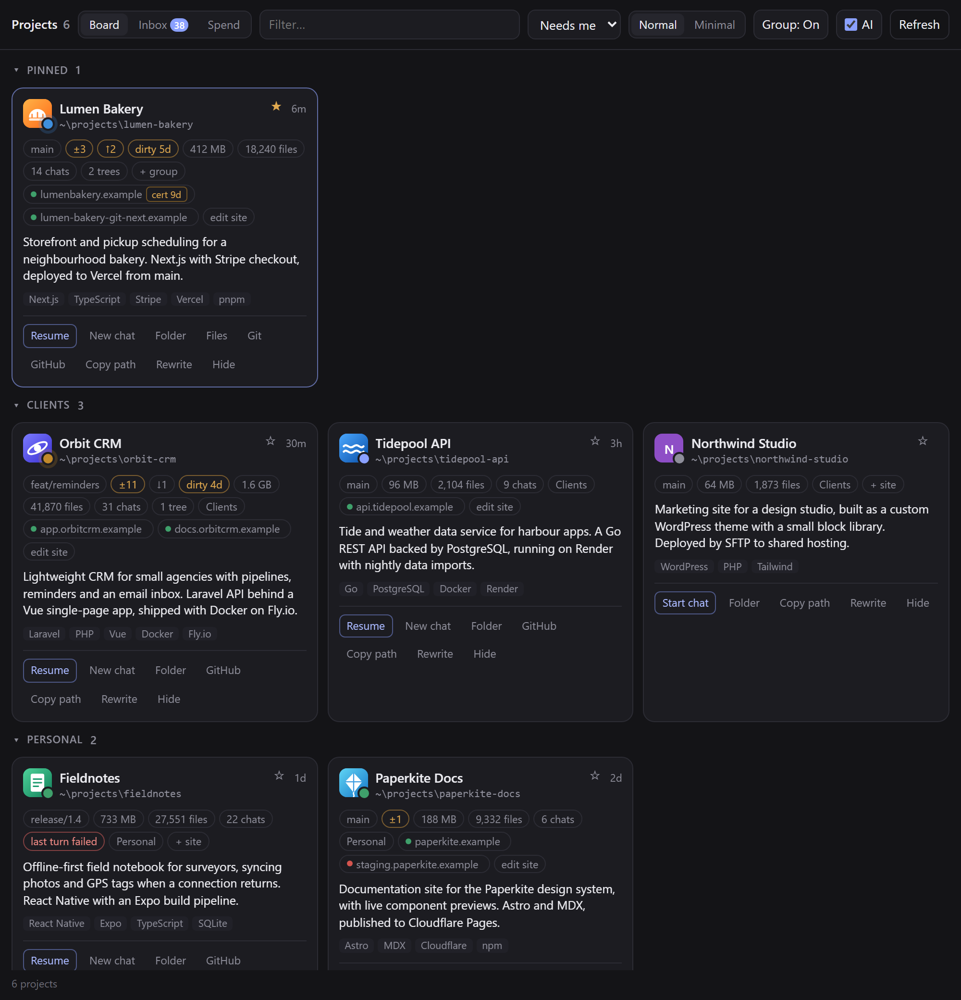
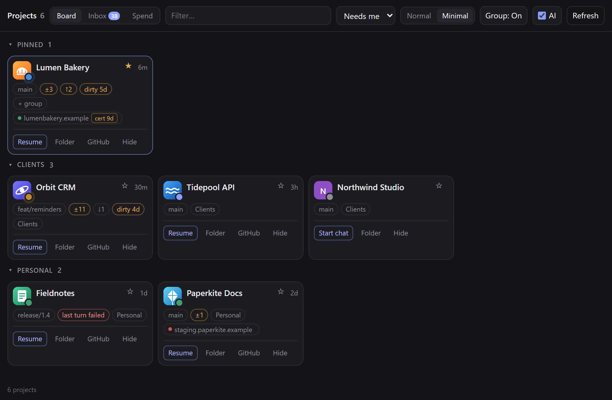
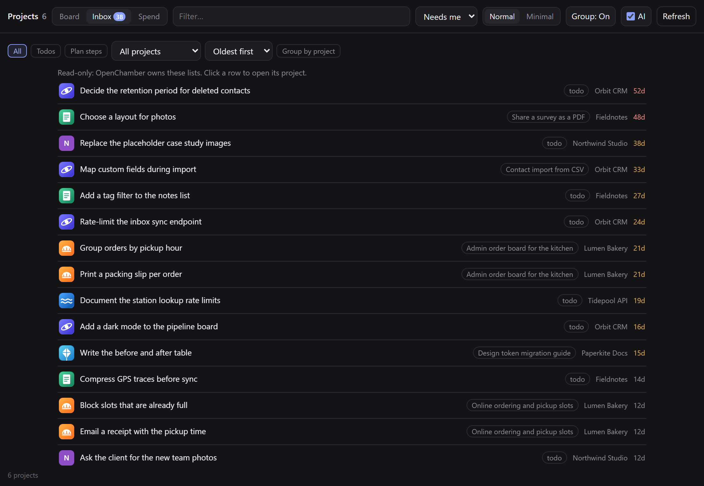
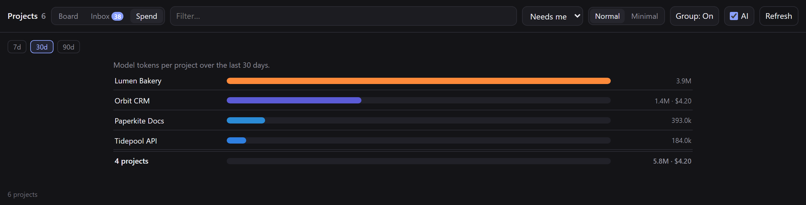
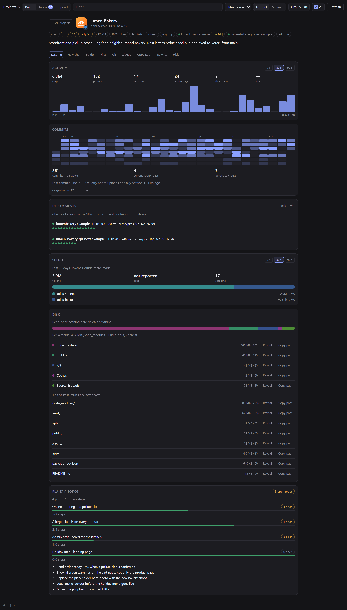
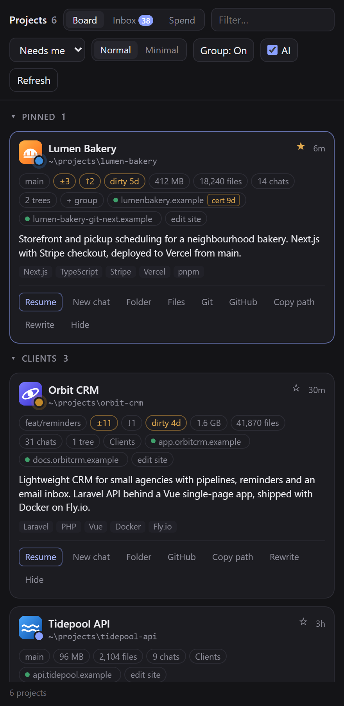
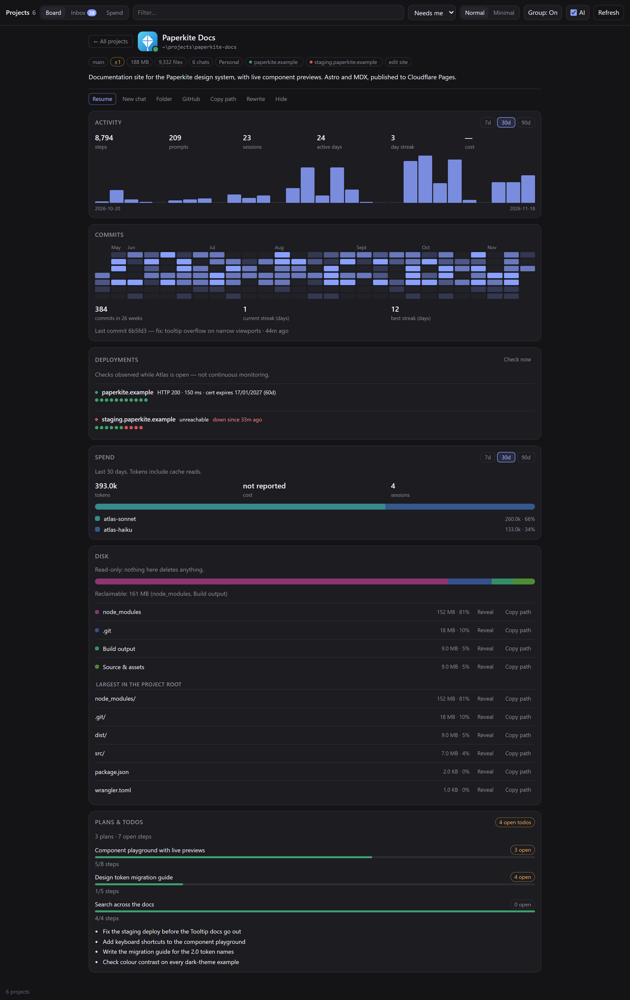
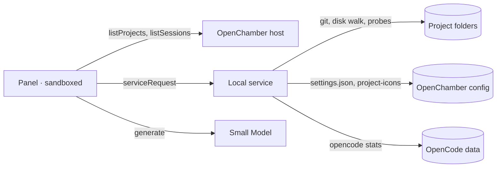

# Project Atlas

A project cockpit for [OpenChamber](https://openchamber.dev): every project you have open in
one board, with its real icon, live status, size, deployments and recent chats — plus a
project page with a GitHub-style activity graph and the plans and todos you still owe.










<p>
  
  
</p>



<sub>Screenshots use invented demo projects, rendered by the real panel code through
[a mock host](docs/DEVELOPMENT.md#screenshots). Light theme: [board-light.png](docs/screenshots/board-light.png).</sub>

Project Atlas is an OpenChamber extension: a sandboxed panel and a small local service. The
panel draws the board and never touches your disk; the service does the things a web page
cannot — `git`, a recursive disk walk, deployment checks, and reading OpenChamber's own
project metadata.

## Features

- **Board** — a full-screen page, and the same board in the rail. Search, sort by "needs me",
  recent, name or size. Pin the important ones, group them into sections, hide the rest.
  **Minimal** density keeps every attention-driving chip on a compact card.
- **Inbox** — one tab with every open todo and plan step across projects, oldest first.
  Filter by kind or project, group by project, click a row to open it. Read-only.
- **Spend** — per-project model tokens (and cost when reported) on the project page and
  as ranked bars on the Spend tab. Tokens are the honest metric; many setups report no cost.
- **Disk** — the project page breaks the folder into `node_modules`, `vendor`, `.git`,
  build output, caches, virtualenvs and source, names what is reclaimable, and reveals or
  copies any row. Strictly read-only: nothing deletes.
- **Real project icons** — the uploaded icon and colour from OpenChamber's project list, with
  a repo `favicon` and a coloured initial as fallbacks.
- **Vitals** — branch, dirty file count, unpushed (`↑N`) / behind (`↓N`) commits, stale
  dirty files (`dirty Nd`), disk size and file count, stack chips
  (`Next.js`, `Laravel`, `Docker`, `pnpm`…), chats, worktrees and last activity.
- **Deployments** — detected from `CNAME`, `homepage`, `.env` URLs, `fly.toml`,
  `wrangler.toml`, `.firebaserc`, `render.yaml` and `gh-pages`, each probed for a live
  status, response time and (for `https`) certificate expiry. Add a URL by hand when
  detection cannot know it.
- **Project page** — click a project name: activity over 7 / 30 / 90 days, a 26-week
  **Commits** heatmap with streaks and the last commit, the **Deployments** panel with
  recent-check dots and "down since", the **Spend** panel (tokens, cost when reported,
  model share) and the **Disk** breakdown, then the plans with open steps and the open
  todos.
- **AI blurb** — two lines per project, written by your Small Model from the README, cached
  and regenerable.
- **Actions** — resume the last chat, start a new one, open the folder, Files, Git, GitHub,
  a deployment, or copy the path.

## Requirements

- OpenChamber **2.7.0** or newer.
- `git` on `PATH`.
- The `opencode` CLI for the activity graph. Without it the page still shows plans and todos.
- Node 20+ only if you build from source. OpenChamber runs the service with its own runtime.

Verified on Windows 11. Linux and macOS are expected to work: the service uses
`~/.config/openchamber` (or `$XDG_CONFIG_HOME/openchamber`) and `open` / `xdg-open`.

## Install

### From GitHub (recommended)

1. In OpenChamber, open **Settings → Extensions**.
2. Paste the repository URL:

   ```
   https://github.com/salehuddin/project-atlas
   ```

3. Choose **Add** and approve the permission dialog.
4. Open **Pages → Project Atlas**, or the folders icon on the right rail.

Git installs can update: when a new version is pushed, OpenChamber offers the update in
Settings → Extensions.

### From a folder (development)

```sh
git clone https://github.com/salehuddin/project-atlas
cd project-atlas
npm ci
npm run build
```

Then **Settings → Extensions**, paste the absolute path of the folder, **Add**, approve.
Folder installs run in place, so after `npm run build` just reopen the panel.

## Permissions

The approval dialog lists exactly this:

| Permission | Why |
| --- | --- |
| Read projects and sessions | The board: project list, chats, unread, running tools |
| Send messages in your sessions | **Start chat** sends a first message |
| Use your Small Model | The two-line project blurbs |
| Run a local service | Disk size, git, deployment checks, Explorer, icons |

The service is not sandboxed — it runs with your user rights, like any local tool. It only
reads the paths the panel sends, OpenChamber's config directory, and runs `git` and
`opencode`. Deployment probes make one plain HTTPS request per URL plus a short TLS
handshake (port 443, SNI) to read the certificate — nothing else leaves your machine.
See [docs/HOW-IT-WORKS.md](docs/HOW-IT-WORKS.md) for the exact reads and the
network calls it makes.

## Using it

- **The name** opens the project page; **← All projects** returns. Tabs switch between
  **Board**, **Inbox** and **Spend**; the project page always renders in full.
- **Normal | Minimal** switches card density. Minimal hides stats and descriptions but
  never hides a problem: anything that drives "Needs me" stays on the card.
- **Inbox** is your cross-project debt list: open todos and plan steps, oldest first.
  Filter them, then click a row to open its project. It is read-only.
- **Spend** shows model tokens per project (cost only when the setup reports one).
- **Disk** breaks the folder into categories, names what is reclaimable, and reveals or
  copies any row. It never deletes anything.
- **☆/★** pins a card to the top; **+ group** files it into a named section.
  **Group: On/Off** in the header toggles the sections; **Hidden (N)** reveals archived
  projects so you can unhide them.
- **Resume** opens the last chat, **Start chat** creates one when the project is new.
- **Files** and **Git** open those screens for the project that is currently open — the
  extension API always targets the open project, so for others use Resume first.
- **+ site / edit site** stores a live URL per project; it is probed like the detected ones.
- **AI** in the header turns the blurbs off; **Refresh** re-reads git, stack and deployments.

## How it works



| Data | Source |
| --- | --- |
| Projects, chats, worktrees, unread | OpenChamber Host API |
| Icon, colour | `~/.config/openchamber/settings.json` + `project-icons/` |
| Branch, dirty files, remote, ahead/behind | `git` in the project |
| Size, files | recursive walk, cached 12 h, partial results marked `+` |
| Stack | manifests and marker files |
| Deployments | config files + `.env` URLs, then an HTTP check and a TLS handshake from your machine |
| Activity, cost | `opencode stats --json --full` |
| Commits, streaks | `git log` over the last 182 days |
| Plans, todos | `~/.config/openchamber/projects/<id>/context.json` and its markdown |
| Blurb | your Small Model, cached by README hash |
| Pins, groups, hidden, probe history | panel storage (`atlas:v1:meta:*`, `atlas:v1:probes:*`, settings) |

More detail, including every HTTP route the service exposes, is in
[docs/HOW-IT-WORKS.md](docs/HOW-IT-WORKS.md).

## Troubleshooting

| Symptom | Fix |
| --- | --- |
| "The local service is not running" | Approve **Run a local service** in Settings → Extensions, then Retry |
| Icons are letters | That project has no uploaded icon; add one in Settings → Projects, or a `favicon.*` in the repo |
| Activity graph is empty | The `opencode` CLI is not on `PATH`, or the project has no history yet |
| Plans panel says none | The project has no notes, todos or plans in OpenChamber |
| Changes to the code do nothing | The service keeps running old code; toggle the extension off and on |

## Development

```
src/panel/main.ts      board and project page, bundled to panel/main.js (IIFE)
src/panel/index.html   markup and CSS, themed with the --oc-* variables
src/service/main.ts    local service, bundled to service/main.js (CJS)
scripts/build.mjs      esbuild
scripts/check.mjs      validates the manifest against @openchamber/sdk
scripts/smoke.mjs      starts the service and prints real vitals for a folder
```

```sh
npm run build
npm run check
npm test              # typecheck
npm run smoke -- <folder> <projectId>
```

See [docs/DEVELOPMENT.md](docs/DEVELOPMENT.md) and [CONTRIBUTING.md](CONTRIBUTING.md).

## License

MIT — see [LICENSE](LICENSE).
